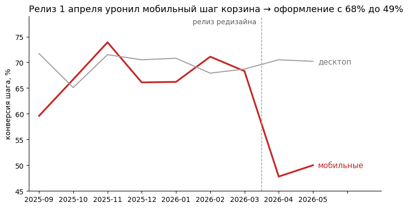

[README.md](https://github.com/user-attachments/files/34543142/README.md)
# Дело Магазина-Х: расследование в данных

Учебный кейс продуктового аналитика: путь от сырых CSV до проведённого
A/B-теста и решения, которое приняло правление.



## Задача

Продакт принёс тикет: «повторные покупки просели, разберись».
За жалобой не было ни цифр, ни сегмента, ни даты — только ощущение.

Нужно было превратить её в измеримый вопрос, найти причину и доказать её.

## Данные

Четыре таблицы публичного датасета курса «Продуктовая аналитика на Python»
(Python Academy):

| Таблица | Что содержит | Строк |
|---|---|---|
| `users` | регистрации, гео, каналы, устройства | 6 000 |
| `products` | каталог товаров | 300 |
| `sessions` | визиты, шаги воронки, устройства | 68 668 |
| `orders` | покупки, суммы, статусы | 7 327 |

Плюс таблица A/B-теста `ab_test_checkout` — 3 000 корзин за 4 недели.

Период: июнь 2025 → май 2026.

## Что нашли

Релиз редизайна мобильного чекаута **1 апреля 2026** уронил конверсию
шага корзина → оформление на мобильных устройствах **с 68% до 49%**.

Магазин недополучал около **14 млн ₽ в месяц**.

A/B-тест на 3 000 корзин доказал причинность:

| Метрика | Значение |
|---|---|
| Конверсия, группа A (старая форма) | 69.5% |
| Конверсия, группа B (новая форма) | 48.6% |
| Разница | +21 п.п. |
| p-value | < 0.001 |
| Выручка на корзину | +4 821 ₽ в пользу старой формы |
| Потери | ~14 млн ₽/мес |

**Что это значит для бизнеса:** мобильный трафик — 58% всех сессий.
Поломка на мобильных бьёт по большей части аудитории. Откат вернул
конверсию к уровню 69.5% — выше доапрельского (68.1%).

## Структура ноутбука

| Фаза | Что внутри | Ячеек |
|---|---|---|
| 1. Данные | первый взгляд, фильтры, группировки, merge, даты | ~20 |
| 2. Метрики | DAU/WAU/MAU, конверсия, чек, ARPU, LTV | ~18 |
| 3. Когорты | retention-матрица, LTV по каналам | ~8 |
| 4. Воронки | общая → сегментированная → во времени | ~12 |
| 5. A/B-тесты | шум, p-value, дизайн, анализ, подглядывание | ~20 |
| 6. Отчёт | цифры одним прогоном, график-вывод | ~6 |
| Финал | карта расследования, мир после отката | ~2 |

Каждая фаза самодостаточна: свои импорты, свой `base`, свой набор ячеек.
Можно открыть любую — она запустится отдельно.

## Методология (кратко)

- **Шаг воронки** ищется через маску `isin([...])` — конверсия между шагами,
  а не от всех сессий.
- **Когорты** считаются не по календарю, а от старта: «14-й день жизни»
  вместо «в апреле» — так группы разных возрастов сравнимы.
- **Разрез по времени** отделяет «было всегда» от «началось в апреле»:
  десктоп стабилен — естественный контроль.
- **A/A-симуляция** даёт коридор шума, **перестановочный тест** — p-value
  без формул.
- **Дизайн эксперимента**: MDE, размер групп, день финиша — фиксируются
  до старта.
- **Подглядывание**: при 28 проверках доля ложных побед ~33% против 5%
  при одной.
- **Анализ A/B** идёт по протоколу: SRM → главная метрика → вторичные
  → деньги.

## Стек

- Python 3.10+
- pandas, numpy, matplotlib

## Как воспроизвести

### В браузере (без установки)

Откройте `investigation_ru.ipynb` в [Google Colab](https://colab.research.google.com/),
нажмите `Среда выполнения → Выполнить все`.

### Локально

```bash
pip install pandas numpy matplotlib jupyter
jupyter notebook investigation_ru.ipynb
```
